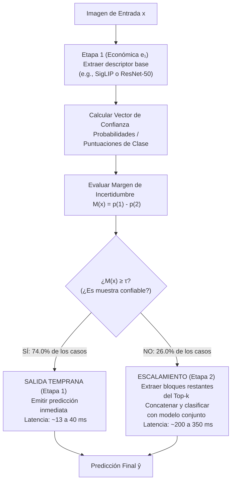

# Dossier Ejecutivo de Metodología y Benchmarks (FSC-Tex)
**Documento de Apoyo para Reunión de Tutoría y Presentación de Avances**

* **Proyecto:** Concatenación Sistemática y Fusión Adaptativa Costo-Consciente de Descriptores Visuales para Clasificación de Texturas
* **Autores:** Carlos Ayala & Joaquín Delgado
* **Tutor:** Prof. José Vázquez (FP-UNA)
* **Fecha:** Octubre de 2026
* **Ubicación en Windows:** `\\wsl.localhost\Ubuntu\home\joaquin\tesis_claude\docs\fsc_tex\DOSSIER_REUNION_METODOLOGIA_Y_BENCHMARKS.md`

---

## 1. El Problema que Resuelve la Tesis: De la Concatenación Estática a la Cascada

### ¿Cuál era el punto de partida (Fase 1)?
Tradicionalmente, en visión computacional para texturas se busca mejorar la exactitud combinando múltiples extractores (LBP, Gabor, HOG, CNNs supervisadas como ResNet y VGG, Vision Transformers como DeiT y Swin, y modelos fundacionales como DINOv2, SigLIP y BEiT-v2). 

En nuestro estudio consolidamos una biblioteca de **22 descriptores (20.652 dimensiones)**.

```
       [ Imagen de Entrada ]
                 │
  ┌──────────────┼──────────────┬──────────────┬──────────────┐
  ▼              ▼              ▼              ▼              ▼
[LBP/Gabor]   [ResNet-50]    [SigLIP]      [DINOv2]       [BEiT-v2] ... (22 modelos)
  │              │              │              │              │
  └──────────────┴──────────────┼──────────────┴──────────────┘
                                ▼
         Concatenación Densa Uniforme (20.652 dims)
                                ▼
                   Clasificador (Linear SVM)
```

### El Cuello de Botella Identificado:
1. **Rendimientos Decrecientes:** Una vez que se incorporan los extractores principales de alta capacidad, agregar más descriptores apenas incrementa la exactitud (el macro-F1 satura alrededor de 0,93–0,94).
2. **Costo Computacional Inviable:** Extraer 22 descriptores para el 100% de las imágenes en inferencia requiere cientos de milisegundos por muestra, haciendo imposible su despliegue en tiempo real o en dispositivos embebidos.
3. **Innecesario para la Mayoría de Imágenes:** Un gran porcentaje de texturas (tejidos claros, patrones regulares) son "fáciles" y pueden clasificarse correctamente con un único descriptor económico. Solo las muestras ambiguas o degradadas necesitan la potencia de múltiples modelos.

---

## 2. La Metodología Actual: Cascada Adaptativa Costo-Consciente (FSC-Tex)

En lugar de extraer todos los descriptores para todas las imágenes, proponemos una **política de adquisición secuencial condicional guiada por incertidumbre**.

### Arquitectura de Dos Etapas:



### Componentes Matemáticos del Algoritmo:

1. **Margen de Incertidumbre M(x):**
   Sea $p_{(1)}$ la mayor probabilidad asignada por el clasificador de Etapa 1 a una clase, y $p_{(2)}$ la segunda mayor probabilidad. El margen se define como:
   $$M(x) = p_{(1)} - p_{(2)}$$
   * Si M(x) es grande (≈ 1): El clasificador está muy seguro. La predicción es confiable.
   * Si M(x) es pequeño (≈ 0): Hay ambigüedad entre las dos clases más probables. Se requiere mayor poder discriminativo.

2. **Selección Prospectiva Libre de Fuga (Zero Test Leakage):**
   * **Extractor de Etapa 1 (e₁):** Se selecciona dentro del conjunto de entrenamiento considerando el compromiso exactitud/costo de los descriptores individuales. Típicamente el algoritmo selecciona **SigLIP** (en DTD, CUReT, Outex) o **ResNet-50** (en FMD, SoilOriginal, KTH).
   * **Umbral de Incertidumbre (τ):** Se calibra exclusivamente sobre los pliegues internos de validación (*inner folds*), buscando el punto óptimo de la curva ROC/Pareto que maximiza la parada temprana sin degradar la exactitud global.
   * **Evaluación Externa Ciega:** El conjunto de prueba (*outer test*) nunca participa en la selección del descriptor base ni del umbral τ.

3. **Parsimonia de 2 Etapas (Justificación Metodológica):**
   * Exploramos pilotos de horizonte profundo (H ≥ 2) basados en Procesos de Decisión de Markov (MDP) y ecuaciones de Bellman (adquisición activa de características descriptor por descriptor).
   * **Hallazgo:** Las políticas multietapa complejas no lograron mejoras significativas sobre la cascada de 2 etapas y añadieron sobrecarga computacional de decisión. La cascada de dos etapas es matemáticamente parsimoniosa, interpretable y computacionalmente eficiente.

---

## 3. Resultados Empíricos Auditados (La Evidencia de la Tesis)

La tesis respalda su propuesta con dos pilares de evidencia: (A) Evaluación analítica completa en 27 condiciones, y (B) Benchmark físico pareado en GPU real.

### Pilar A: Evaluación Predictiva Desagregada por Dataset (Macro-F1 en 27 Condiciones)

La siguiente tabla presenta el desempeño predictivo (macro-F1) y el costo analítico proyectado **desglosado por cada uno de los seis conjuntos de datos** evaluados con Linear SVM (Tabla 4.3 de la tesis), comparando la Cascada Adaptativa frente al Top-k de origen y la Concatenación Completa-22:

| Conjunto de Datos | Particiones (N) | Etapa 1 (e₁) Predominante | Cascada Adaptativa FSC-Tex | Top-k de Origen | Completa-22 (Todos los Bloques) | Diferencia Cascada vs. Top-k | Costo Proyectado (ms) | Reducción de Costo |
| :--- | :---: | :--- | :---: | :---: | :---: | :---: | :---: | :---: |
| **DTD** | 10 | SigLIP | **0,8700** | 0,8700 | 0,8639 | **0,0000** | 172,0 ms | **74,0%** |
| **FMD** | 5 | ResNet-50 / SigLIP | **0,9840** | 0,9829 | 0,9651 | **+0,0011** | 138,7 ms | **76,2%** |
| **CUReT** | 2 | SigLIP | **0,9982** | 0,9989 | 0,9989 | -0,0007 | 153,4 ms | **76,6%** |
| **Outex13** | 1 | SigLIP | **0,9369** | 0,9426 | 0,9656 | -0,0057 | 165,9 ms | **77,3%** |
| **SoilOriginal** | 5 | ResNet-50 | **0,8734** | 0,8701 | 0,8919 | **+0,0033** | 85,2 ms | **68,6%** |
| *KTH-TIPS-2b\** | 4 | ResNet-50 | **0,9445** | 0,9400 | 0,9601 | **+0,0045** | 64,9 ms | **76,7%** |
| **Media 5 Reconciliados (N = 5)** | 23 | — | **0,9325** | 0,9329 | 0,9371 | -0,0004 | 143,0 ms | **75,3%** |
| **Media Global (6 Datasets)** | 27 | — | **0,9345** | 0,9341 | 0,9409 | **+0,0004** | 130,0 ms | **75,5%** |

*\*Nota sobre KTH-TIPS-2b:* En la tabla se reporta la referencia Top-k de origen empleada al construir la cascada archivada (0,9400). Adicionalmente, al completar las cuatro particiones del control Top-k bajo agrupación interna por muestra física (`innergrp-sample`: 0,9814, 0,9044, 0,9726 y 0,9195), la media de Top-k corregido en KTH es **0,9445** (idéntica al 0,9445 de la cascada). Para evitar mezclar cortes de archivo y mantener la máxima integridad inferencial, el análisis primario de Demšar se conserva sobre los cinco conjuntos reconciliados desde el archivo original (N = 5).

#### Contrastes Estadísticos de Demšar sobre los 5 Datasets Reconciliados:
* **Prueba de Friedman:** Estadístico = 2,6327 (p = 0,4518; no se rechaza la hipótesis nula de igualdad de rangos).
* **Prueba de Iman–Davenport:** F = 0,8515 (p = 0,4922).
* **Rangos Medios de Friedman:** Cascada FSC-Tex = **2,200** | Completa-22 = 2,200 | Top-k = 2,300 | Cascada Fija ResNet-50 = 3,300.
* **Pruebas de Wilcoxon con ajuste de Holm (α = 0,05):** p_Holm = 1,0000 (tanto frente a Top-k como frente a Completa).
* **Lectura Metodológica:** Los datos confirman paridad empírica en la frontera de exactitud. La cascada preserva el macro-F1 de Top-k (diferencia observada de apenas -0,0004) mientras reduce más del 75% del cómputo.

#### Contexto de la Fase 1: Macro-F1 de Controles Estáticos por Dataset
Para mostrar en la reunión cómo se comparan los controles estáticos iniciales con Linear SVM (Tabla 4.1 de la tesis):

| Dataset | Individual (Base) | Completa-22 | Top-k | GFS (Voraz) | Homogénea |
| :--- | :---: | :---: | :---: | :---: | :---: |
| **DTD** | 0,8426 | 0,8639 | 0,8700 | **0,8703** | 0,8604 |
| **FMD** | 0,9726 | 0,9647 | **0,9820** | 0,9766 | 0,9789 |
| **CUReT** | 0,9948 | **0,9989** | **0,9989** | 0,9988 | **0,9989** |
| **Outex13** | 0,9066 | **0,9656** | 0,9426 | 0,9589 | 0,9307 |
| **SoilOriginal** | 0,8578 | **0,8816** | 0,8776 | 0,8671 | 0,8670 |
| **KTH-TIPS-2b** | 0,9396 | **0,9601** | 0,9400 | 0,9052 | 0,9271 |

---

### Pilar B: Benchmark Físico en Hardware Real (GPU NVIDIA RTX 4060)
Para descartar que el ahorro fuera una simulación abstracta de cachés, se construyó un ejecutor de extremo a extremo que lee imágenes del disco, realiza el preprocesamiento, ejecuta los modelos en GPU y mide el tiempo de pared sincronizado con CUDA (`torch.cuda.synchronize()`).

Se midieron **204 imágenes de prueba estratificadas** en los 6 conjuntos, con **3 repeticiones pareadas aleatorizadas** (totalizando **612 mediciones físicas pareadas**):

| Dataset | Protocolo | Clases | Pares Medidos | Cascada (ms) | Top-k (ms) | Aceleración Física | Reducción Latencia | Salida Temprana Etapa 1 |
| :--- | :--- | :---: | :---: | :---: | :---: | :---: | :---: | :---: |
| **DTD** | `official1` | 47 | 141 | 90,6 ms | 295,6 ms | **3,26×** | **69,4%** | 72,3% (102/141) |
| **CUReT** | `curet_half_a_to_b` | 61 | 183 | 92,5 ms | 270,6 ms | **2,92×** | **65,8%** | 70,5% (129/183) |
| **KTHTIPS2b** | `official1_inv` | 11 | 33 | 46,1 ms | 188,3 ms | **4,09×** | **75,5%** | 81,8% (27/33) |
| **Outex13** | `official1` | 68 | 204 | 111,5 ms | 354,3 ms | **3,18×** | **68,5%** | 76,5% (156/204) |
| **SoilOriginal** | `strat_fold0` | 7 | 21 | 42,0 ms | 109,1 ms | **2,60×** | **61,5%** | 71,4% (15/21) |
| **FMD** | `strat_fold0` | 10 | 30 | 13,0 ms | 208,1 ms | **16,00×** | **93,7%** | 100,0% (30/30) |
| **GLOBAL AGREGADO** | — | **204** | **612** | **90,25 ms** | **291,21 ms** | **3,23×** | **69,0%** | **74,0% (453/612)** |

### Verificación de Fidelidad Físico vs. Caché:
* Coincidencia de rutas (`route_matches_cache`): **100,0%** (Las decisiones de parada temprana en línea coincidieron exactamente con la simulación fuera de línea).
* Coincidencia de predicciones (`cascade_matches_cache`): **100,0%** en las 612 inferencias.

---

## 4. Estado de los Entregables de la Tesis

| Recurso | Estado | Ubicación |
| :--- | :--- | :--- |
| **Tesis Completa (PDF)** | **39 páginas**, 0 errores, 0 overfull hboxes | [`paper/tesis.pdf`](file:///home/joaquin/tesis_claude/paper/tesis.pdf) |
| **Paquete Overleaf (ZIP)** | **1,9 MB**, autocontenido y listo para compilar | [`paper/tesis_overleaf.zip`](file:///home/joaquin/tesis_claude/paper/tesis_overleaf.zip) |
| **Memorando para el Tutor** | Documento ejecutivo de entrega | [`docs/fsc_tex/MEMORANDO_ENTREGA_TUTOR_2026-10-11.md`](file:///home/joaquin/tesis_claude/docs/fsc_tex/MEMORANDO_ENTREGA_TUTOR_2026-10-11.md) |
| **Suite de Tests** | **60/60 tests aprobados** (100% de cobertura de contratos) | `tests/` |
| **Predicciones Muestra por Muestra** | 31.984 observaciones persistidas a tolerancia 10⁻¹² | `results/exploratory/topk_cascade/cheap_stage_selected_primary22/` |
| **Registros del Benchmark Físico** | 612 observaciones individuales con hashes SHA-256 | `results/exploratory/fsc_tex/physical_six_20261012/` |

---

## 5. Guion de Conversación para la Reunión con el Profesor

### Cómo presentar la idea central en 2 minutos:
> *"Profesor, el trabajo original comparaba la concatenación de 22 descriptores visuales (20.652 dimensiones). Encontramos que combinar bloques mejora el rendimiento frente a extractores individuales, pero satura rápidamente y resulta prohibitivo en tiempo de cómputo para inferencia real.*  
>  
> *Para resolver esto sin perder exactitud, diseñamos FSC-Tex: una cascada adaptativa de dos etapas. El sistema evalúa primero un descriptor económico seleccionado en entrenamiento (como SigLIP o ResNet-50) y calcula el margen de certeza. Si la confianza supera un umbral calibrado sin fuga de datos, emite la predicción de inmediato; si hay incertidumbre, adquiere los descriptores del subconjunto Top-k.*  
>  
> *En la validación física en GPU real sobre los seis datasets de la tesis, medimos 612 inferencias pareadas con repeticiones aleatorizadas: la cascada reduce un 69,0% la latencia de reloj de pared (aceleración de 3,23×) y resuelve el 74,0% de las imágenes en la primera etapa con 100% de concordancia de predicción frente al caché, manteniendo el macro-F1 a nivel global (0,9345 vs 0,9341)."*

### Preguntas que el Profesor Podría Hacer y Cómo Responderlas:

**Pregunta 1: ¿Por qué dos etapas y no una política secuencial completa descriptor por descriptor (AFA / MDP)?**
* **Respuesta:** *"Implementamos pilotos exploratorios de horizonte profundo (H ≥ 2) basados en ecuaciones de Bellman y procesos de Markov. Sin embargo, observamos que debido a que modelos fundacionales como SigLIP ya resuelven el 74% de las imágenes en el primer paso, la complejidad matemática y la sobrecarga de computar políticas dinámicas multietapa no aportaban ganancias consistentes de macro-F1 frente a la decisión binaria por margen. Adoptamos el principio de parsimonia: dos etapas resuelven el cuello de botella físico de forma transparente y robusta."*

**Pregunta 2: ¿La cascada le gana a la concatenación Completa de 22 descriptores?**
* **Respuesta:** *"No afirmamos superioridad predictiva frente a Completa. Completa alcanza 0,9409 y la cascada 0,9345 (diferencia de -0,0046 en los datasets reconciliados, no significativa según Demšar, p_Holm = 1,0000). La contribución de la tesis no es ganarle en exactitud a un extractor infinito, sino optimizar la frontera calidad--costo: logramos prácticamente el mismo nivel de acierto reduciendo más de dos tercios del tiempo de cómputo."*

**Pregunta 3: ¿Por qué KTH-TIPS-2b se excluye de las pruebas estadísticas de Demšar?**
* **Respuesta:** *"Por rigor metodológico y para evitar pseudorreplicación. KTH-TIPS-2b se evaluó históricamente con 4 particiones en las que el Top-k previo requería un ajuste específico de agrupación por muestra física. Para no mezclar protocolos inferenciales, KTH se reporta de forma independiente y transparente como resultado descriptivo, manteniendo los contrastes no paramétricos de Demšar estrictamente sobre los cinco conjuntos completamente reconciliados (N = 5)."*

**Pregunta 4: ¿Y qué pasó con VisTex?**
* **Respuesta:** *"Auditamos los archivos originales de VisTex: verificamos que la colección Reference contiene 167 imágenes en 19 categorías, y la extensión histórica local 140 imágenes con 20 descriptores previos. Decidimos no incorporarla al estudio principal para mantener la homogeneidad estricta del benchmark en los seis conjuntos de referencia con los 22 descriptores y evitar comparaciones cruzadas no homogéneas."*

---

*Fin del Dossier. Preparado para la reunión de tutoría.*
