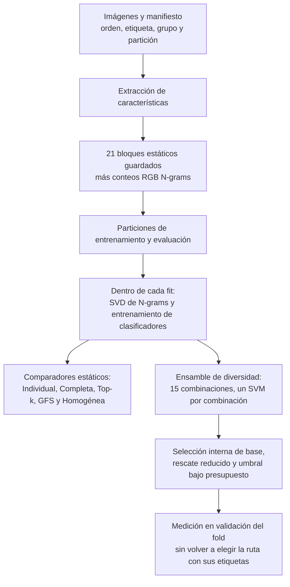
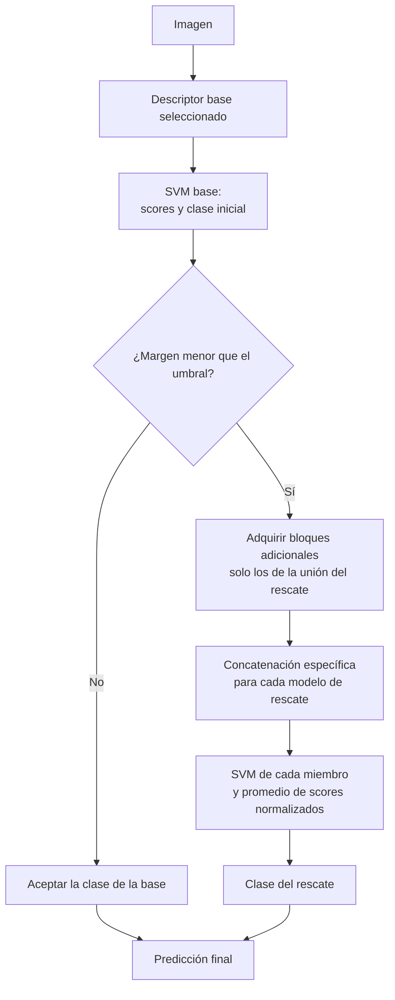

# Cómo funciona el método: de la imagen a la cascada adaptativa

**Actualización:** 23 de octubre de 2026. Guía técnica y explicativa del código actual, no sustituto del protocolo del manuscrito.

## Material Passport

- Origin Skill: academic-research-suite.
- Origin Mode: explicación técnica sustentada en código y artefactos locales.
- Verification Status: ANALYZED; lectura de fuentes y comprobación de dimensiones, sin nuevos entrenamientos.
- Version Label: guia_metodo_v1.

## 1. La idea en una frase

**Transformamos una imagen en varios bloques de características, entrenamos clasificadores sobre combinaciones de esos bloques y estudiamos cuándo conviene activar un ensamble reducido en lugar de ejecutar todos los extractores para todas las imágenes.**

Hay tres decisiones diferentes:

| Decisión | Pregunta |
|---|---|
| Extracción | ¿Qué números representan la imagen? |
| Selección y combinación | ¿Qué bloques entran en cada clasificador y qué clasificadores combinamos? |
| Enrutamiento | ¿Esta imagen termina en la base o necesita el rescate? |

Top-k y GFS seleccionan bloques. Un ensamble combina clasificadores. Una cascada decide qué ruta usar para cada imagen. No son nombres distintos de lo mismo.

## 2. Mapa general



Este mapa describe las fases del experimento. No significa que se calculen los 22 bloques para cada imagen en una implementación de inferencia selectiva. La diferencia entre el experimento con caché y dicha implementación se explica en la sección 11.

## 3. ¿Qué es una feature o característica?

Una imagen es una matriz de píxeles. Un extractor transforma esos píxeles en un vector numérico:

```text
imagen x → extractor j → vector f_j(x) de dimensión d_j
```

Un bloque puede describir patrones locales, orientaciones, coocurrencias o representaciones aprendidas por una red. No es, por sí mismo, la predicción de la clase de textura.

Ejemplos reales de la biblioteca:

- LBP produce 54 valores.
- HOG produce 1.764 valores.
- ResNet-50 produce 2.048 valores.
- DINOv2-small produce 384 valores.
- BEiT-v2-final produce 768 valores.
- RGB N-grams+SVD aporta hasta 256 valores según el tamaño del fit.

**Extractor y clasificador son cosas distintas:** ResNet puede producir el vector, y un SVM entrenado con las clases de nuestro dataset produce la decisión final. No usamos las clases originales de ImageNet como etiquetas de textura.

## 4. Cómo extraemos las características

### 4.1 Primero fijamos qué representa cada fila

El manifiesto vincula cada imagen con su identificador, etiqueta y grupo. Para cada extractor guardamos una matriz de forma `n_imágenes × d_j`, respetando el mismo orden de filas, junto con etiquetas y metadatos disponibles.

El cargador verifica matrices bidimensionales, valores finitos y correspondencia de etiquetas. El manifiesto debe cubrir exactamente el orden de filas. La mera coincidencia del número de imágenes no prueba por sí sola identidad de su orden o de las fuentes.

Esta alineación permite concatenar la fila de una imagen en DINOv2 con la fila de esa misma imagen en HOG, sin mezclar imágenes distintas.

### 4.2 Descriptores clásicos

La implementación clásica convierte a escala de grises y redimensiona según el descriptor:

- **LBP:** histogramas de patrones binarios locales en varias escalas.
- **GLCM:** propiedades de matrices de coocurrencia para distancias y orientaciones configuradas.
- **Gabor:** media y desviación de respuestas a filtros con varias frecuencias y orientaciones.
- **HOG:** histogramas de orientaciones de gradiente.
- **DRLBP:** variante implementada mediante histogramas LBP y rotaciones.

No requieren entrenar una red con las etiquetas del dataset. Sus tamaños y parámetros son los de esta implementación; no asumir que cualquier implementación de un descriptor con el mismo nombre sea idéntica.

### 4.3 Extractores aprendidos y congelados

Se cargan pesos preentrenados, se coloca el modelo en modo evaluación y se hace un forward sin gradientes. En estos pilotos no se reajustan los pesos del backbone con las etiquetas de texturas: se entrena después el clasificador sobre sus vectores.

El preprocesamiento depende del modelo: conversión a RGB, tamaño de entrada, normalización y, cuando corresponde, recorte. No todos reciben un preprocesamiento universal idéntico. Los extractores `timm` usan `num_classes=0` y su salida de características; los de Hugging Face emplean la salida indicada por el código, por ejemplo `pooler_output` cuando está disponible o el primer token como alternativa.

EVA02, MAE y SigLIP tienen rutas específicas; SigLIP utiliza su componente visual. BEiT-v2-final se extrae mediante su ejecutor específico. El nombre del backbone no alcanza para reproducir una representación: también importan checkpoint, librerías, preprocesamiento y capa/salida empleada.

### 4.4 RGB N-grams: la excepción que se aprende por fold

El bloque actual parte de conteos de patrones locales de píxeles RGB. En la implementación usada por los pilotos (`rgb_ngram_impl1`) se cuantizan canales con rango 12 y se codifican ventanas verticales de altura 2, conjuntamente entre canales.

```text
imagen RGB
   ↓
conteos de patrones, sin etiquetas
   ↓
hashing determinista a 8.192 posiciones
   ↓
TruncatedSVD ajustada SOLO con las filas del fit
   ↓
hasta 256 componentes y normalización L2
```

Los conteos por imagen pueden guardarse una vez porque no aprenden de otras imágenes ni de las etiquetas. El hashing es fijo; en la implementación actual no se aprende un vocabulario global con el test. Lo que sí se aprende es la proyección SVD, separadamente en cada fit interno o productor.

Para validar una imagen se aplica la SVD ya ajustada con el entrenamiento correspondiente; no se vuelve a ajustarla con la validación. Tampoco se trata N-grams como un `.npy` global proyectado con todo el dataset.

## 5. Qué bloques tenemos y cómo se normalizan

Dimensiones comprobadas en las matrices del piloto Outex; N-grams indica su dimensión nominal:

| Bloque | Dimensión | Bloque | Dimensión |
|---|---:|---|---:|
| BEiT-v2-final | 768 | ConvNeXt-v2-tiny | 768 |
| DeiT-small | 384 | DenseNet-121 | 1.024 |
| DINOv2-base | 768 | DINOv2-large | 1.024 |
| DINOv2-small | 384 | DRLBP | 80 |
| EfficientNet-B0 | 1.280 | EVA02-base | 768 |
| Gabor | 48 | GLCM | 18 |
| HOG | 1.764 | LBP | 54 |
| MAE-base | 768 | ResNet-101 | 2.048 |
| ResNet-50 | 2.048 | SigLIP-base | 768 |
| Swin-tiny | 768 | VGG16 | 4.096 |
| ViT-B/16 | 768 | RGB N-grams+SVD | 256 |

Son 21 bloques estáticos de 20.396 dimensiones y el bloque N-grams de hasta 256: **22 bloques, 20.652 dimensiones nominales**. La variante BEiT-v2 multilayer no forma parte de esta biblioteca principal.

Al cargar cada bloque estático se normaliza cada vector por su norma L2. La representación N-grams proyectada también se normaliza por fila. Esto limita diferencias de magnitud entre bloques, pero no garantiza independencia, ausencia de redundancia ni una contribución idéntica a la clasificación.

Después se concatenan los bloques seleccionados; el código descrito no añade por defecto PCA, LDA ni una segunda reducción global a esa concatenación.

## 6. Qué significa concatenar

Concatenar es colocar vectores uno después del otro para entrenar **un solo clasificador**:

```text
ResNet-50:   [2.048 valores]
DINOv2-small:[  384 valores]
HOG:         [1.764 valores]
                  ↓
vector conjunto de 4.196 valores → un SVM
```

No se suman vectores de distinto tamaño ni se promedian sus predicciones en este paso. Es fusión a nivel de características.

### Estrategias estáticas

| Estrategia | Qué selecciona | Qué clasificador utiliza |
|---|---|---|
| Individual | Un bloque por ranking interno | Un clasificador sobre ese bloque |
| Completa | Todos los bloques de la biblioteca fijada | Un clasificador sobre la concatenación completa |
| Top-k | Los k primeros del ranking individual | Un clasificador sobre su concatenación |
| GFS | Un subconjunto construido por búsqueda hacia adelante | Un clasificador sobre la combinación seleccionada |
| Homogénea | Un subconjunto dentro de una familia | Un clasificador sobre esa concatenación |

El benchmark estático incluye SVM y ResMLP; los pilotos nuevos de selección presupuestada y rescate híbrido aquí explicados utilizan Linear SVM. Los resultados y contrastes de un clasificador no se transfieren al otro.

## 7. Cómo usamos Top-k y GFS realmente

### 7.1 Ranking individual

Dentro del entrenamiento se evalúa cada bloque por separado con validación interna. Se obtiene su macro-F1 y se ordenan los bloques. El ranking no se calcula mirando el F1 del test externo.

Un ranking alto significa que el bloque funciona bien solo. No demuestra que aporte información complementaria cuando se une con otros.

### 7.2 Top-k

Si el ranking fuese `A, B, C, D...`, Top-3 seleccionaría `A+B+C`, entrenando un único clasificador sobre esos bloques.

Hay dos usos que no deben confundirse:

1. **Control Top-k del benchmark:** `run_topk_individual_control.py` toma el valor de k del GFS archivado para la misma condición y clasificador, recalcula el ranking interno y concatena sus primeros k bloques. Es una comparación a igual número de bloques; no una búsqueda nueva del mejor k en el test.
2. **Controles de los pilotos recientes:** se evalúan explícitamente Top-3, Top-4 y Top-5 como referencias fijas de tamaño. “Top-5” no representa automáticamente al mejor Top-k de toda búsqueda posible.

**¿N-grams participa?** Sí cuando se ejecuta la biblioteca de 22: puede ser candidato del ranking y entrar si su posición alcanza el corte. No se añade obligatoriamente a todo Top-k. La ablación de 21 lo excluye expresamente. Los candidatos con/sin color del pool emparejado son otra construcción, no una redefinición de Top-k.

### 7.3 GFS: Greedy Forward Selection

GFS busca qué bloque mejora la combinación actual:

```text
1. Evaluar cada bloque solo; empezar por el mejor.
2. Añadir provisionalmente cada bloque restante.
3. Evaluar las concatenaciones en los folds internos.
4. Incorporar el candidato con mayor F1 interno.
5. Repetir y conservar el mejor prefijo visitado.
```

En `run_confirmatory_nested.py`, la búsqueda respeta `max_k` y se detiene tras dos incrementos consecutivos inferiores a 0,001. Conserva el mejor subconjunto visitado, no necesariamente el último. No examina todas las combinaciones ni garantiza un óptimo global.

Así, GFS puede preferir `A+C+F` aunque Top-3 sea `A+B+C`: F puede ser mediocre solo y útil junto a los demás. La selección homogénea aplica una búsqueda restringida a cada familia y compara las opciones internamente.

## 8. Del subconjunto al ensamble de diversidad

El ensamble no es una única concatenación gigante. Cada miembro usa una concatenación distinta y tiene su propio SVM:

```text
Miembro 1: A+B+C+D → SVM 1 → scores por clase
Miembro 2: A+C+E+F → SVM 2 → scores por clase
Miembro 3: B+D+E+G → SVM 3 → scores por clase
                              ↓
                  combinación de scores → clase
```

### Cómo se generan los miembros en el control actual

1. Usar el ranking individual interno como relevancia.
2. Calcular similitud lineal CKA entre representaciones usando solo filas del fit productor.
3. Al construir un subconjunto, descontar a la relevancia una penalización por similitud con los bloques ya elegidos.
4. Sortear favoreciendo los mejores puestos de esa utilidad, sin repetir bloques dentro del subconjunto.
5. Repetir hasta obtener 15 miembros de cuatro bloques cada uno.

El piloto adapta las funciones de Carlos con beta=8, lambda=0,25, k=4 y 15 sorteos. CKA mide similitud de representaciones; no demuestra independencia ni diversidad de errores. Los parámetros y sorteos se fijan dentro del protocolo, no se eligen con las etiquetas del fold productor de validación.

Para el voto soft se promedian scores normalizados de los SVM, no se promedian sus vectores de características. Cada escala de scores es un escalar calculado con la desviación de scores del entrenamiento del modelo y queda congelado al evaluar; no se recalcula con el lote de validación. No son probabilidades calibradas.

Si un mismo subconjunto aparece varias veces, se preserva su multiplicidad en el voto del ensamble completo, aunque se ajuste/ejecute el modelo único una vez. Los 15 miembros no implican necesariamente 15 modelos distintos.

## 9. Cómo construimos el rescate reducido

Ahora añadimos una selección sobre los **modelos del ensamble**, no solo sobre descriptores:

1. Obtener scores OOF internos de los modelos candidatos.
2. Considerar como bases los bloques individuales no dominados en calidad/costo.
3. Probar cuantiles de margen 0,1; 0,25 y 0,5.
4. Para cada base y umbral, evaluar qué miembro mejora el F1 de la cascada en los scores internos y respeta el presupuesto.
5. Añadir miembros con mejora positiva hasta un máximo de tres modelos únicos o hasta que no haya mejora admisible.
6. Conservar la mejor ruta interna visitada para cada presupuesto. Base sola también puede ser elegida.

Se comparan dos reglas: **ganancia sola bajo presupuesto** y **ganancia dividida por incremento de costo**. Ambas usan el mismo pool, bases, cuantiles y límite. La selección final prioriza F1 interno y utiliza costo y otros criterios deterministas para desempatar.

En el rescate podado los modelos únicos elegidos reciben el mismo peso. No se está aprendiendo un vector libre de pesos ni preservando necesariamente la ponderación de los 15 votos originales.

**Top-k no decide por sí solo el rescate:** ayuda como ranking/control y es un antecedente de generación de candidatos, pero la variante nueva toma los modelos del ensamble de diversidad y los selecciona considerando la cascada. Tampoco debe confundirse esta poda de modelos con el GFS estático de descriptores.

## 10. Qué ocurre con una imagen: la ruta seleccionada



El margen es la diferencia entre el mayor y el segundo mayor score de la base. Si es menor que el umbral, se activa el rescate; la igualdad no activa la compuerta. Un margen alto es una heurística de certeza, no una garantía de acierto ni una probabilidad.

El umbral se calcula como un cuantil de los márgenes OOF internos de la base. No se recalibra usando las etiquetas del fold productor de validación. Un cuantil del 25 % no asegura que se derive exactamente 25 % de imágenes nuevas.

**Cuando se activa el rescate, su clase reemplaza a la clase de la base.** No se hace un voto adicional entre base y rescate. La representación de la base sí puede reutilizarse como bloque dentro de uno o varios miembros.

### Ejemplo real: Outex, fold productor 0, podado relevancia/B60

La ruta guardada seleccionó:

```text
Base: DINOv2-small → SVM base

Rescate 1:
  BEiT-v2-final + DINOv2-base + DINOv2-small + N-grams → SVM 1

Rescate 2:
  DenseNet-121 + DINOv2-base + DINOv2-small + N-grams → SVM 2

Salida de rescate: promedio de los scores de SVM 1 y SVM 2
```

Al activar ambos modelos, no se calculan dos veces DINOv2-base o N-grams, y DINOv2-small ya se obtuvo en la base. La unión tiene cinco bloques y se adquieren cuatro adicionales. Cada SVM recibe su concatenación propia, no obligatoriamente los cinco bloques de la unión.

Este ejemplo contiene **dos modelos de cuatro bloques**, no “Top-2 de dos descriptores”. Es una ruta de un fold; las otras particiones eligieron otras bases y rescates. No existe todavía una ruta universal congelada para los seis datasets.

## 11. La diferencia fundamental: caché experimental e inferencia real

### Lo que hace hoy el piloto híbrido

Se cargan matrices de características previamente extraídas. Se entrenan o reutilizan los clasificadores correspondientes y se obtienen scores de los miembros. El ejecutor aplica la compuerta a sus predicciones para evaluar la política; también dispone de scores de rescate para imágenes que finalmente no se derivan. El ahorro no se obtiene cronometrando en este script la omisión real de todos esos cálculos.

En particular, `run_carlos_hybrid.py` reutiliza scores productores de validación ya auditados del control de Carlos, ajusta los scores internos faltantes y las bases necesarias, y guarda decisiones y predicciones por imagen. Esto conserva una comparación emparejada, pero **no equivale a haber ejecutado el nuevo híbrido completo RGB→predicción con adquisición física selectiva**.

### Lo que debe hacer el ejecutor online del híbrido

```text
Extraer la base → evaluar margen.
Si no hay rescate: no ejecutar los extractores adicionales.
Si hay rescate: ejecutar una vez cada extractor adicional necesario,
               aplicar las transformaciones fijadas en entrenamiento,
               evaluar los modelos y combinar scores.
```

Ya existen pilotos físicos de una cascada anterior, pero sus resultados no se transfieren automáticamente a esta variante nueva. La reproducción de embeddings mantiene reservas en CUReT/Soil. El híbrido necesita su propia implementación/medición física fiel antes de afirmar ahorro de tiempo real.

### Cómo calculamos el costo por ahora

Si hay rescate seleccionado:

```text
costo medio proyectado = costo de la base
                       + overhead de la política
                       + fracción derivada × costo de bloques adicionales únicos
```

Si la ruta seleccionada no tiene rescate, el costo es solo el de la base. La base no se cobra de nuevo dentro del rescate; un descriptor compartido por varios miembros tampoco se cobra varias veces.

El presupuesto restringe esa media en los datos internos de selección, no cada imagen y tampoco garantiza la media de una muestra nueva. El perfil actual no incluye toda la latencia de clasificadores, carga de modelos o residencia en memoria. Se registran llamadas de clasificadores aparte.

## 12. Cómo validamos sin elegir con las etiquetas de evaluación

Para el híbrido de Outex:

```text
Dataset de 1.360 imágenes
 ├─ Entrenamiento oficial: 680
 │   └─ 3 folds productores
 │       ├─ Fit productor
 │       │   └─ 3 folds internos para scores OOF y selección de ruta
 │       └─ Validación productora: medir la ruta ya seleccionada
 └─ Test oficial: no evaluado en este piloto híbrido
```

Cada una de las 680 imágenes recibe una predicción al quedar fuera del fit de su fold productor. El ranking y la CKA que generan candidatos se calculan dentro de ese fit; los scores internos permiten seleccionar la ruta. No se interpreta el F1 usado para seleccionar como una evaluación externa independiente.

El diseño de la investigación estuvo informado por experimentos previos sobre estos benchmarks. No se afirma que el estudio sea una confirmación ciega ni que este esquema, por sí solo, descarte cualquier problema histórico de fuga o procedencia. En KTH importan especialmente los grupos de muestra física.

## 13. Resultado que ilustra el funcionamiento, no una conclusión general

En el nuevo piloto de Outex, el punto podado por relevancia/B60 obtuvo macro-F1 **0,910742** y costo medio proyectado **53,316 ms**; el ensamble de diversidad permanente obtuvo **0,914389** y **365,196 ms**. La reducción de costo estimado es 85,40 %, con una diferencia de F1 de −0,003646.

La ruta derivó 278 de 680 imágenes; en ellas corrigió 52 errores de la base e introdujo cinco errores sobre aciertos de la base. No superó en F1 al ensamble permanente ni a Completa-22. Tampoco se ha demostrado equivalencia, significancia confirmatoria, ahorro físico o generalización a todos los datasets.

La variante de ganancia sola bajo presupuesto fue mejor que la marginal en puntos de este piloto. Por ello aún no se puede atribuir el avance a dividir la ganancia por el costo. Falta, entre otras ablaciones, comparar el mismo ensamble reducido siempre activo con su versión con compuerta.

Resultados, controles y auditorías completos: [resumen vigente](RESUMEN_RESULTADOS_PARA_EXPONER_2026-10-23.md) e [informe del híbrido](CARLOS_RESCATE_HIBRIDO_OUTEX_2026-10-21.md).

## 14. Cómo explicarlo en voz alta

> Primero convertimos las imágenes en bloques numéricos usando descriptores clásicos y redes preentrenadas congeladas. Después comparamos formas de combinar esos bloques. Top-k concatena los mejores individualmente, GFS busca una combinación útil y el ensamble combina varios clasificadores sobre distintas concatenaciones. Nuestra variante actual selecciona una base y un rescate reducido: acepta la decisión de la base cuando el margen es suficiente y activa el rescate cuando hay incertidumbre. Buscamos adquirir únicamente las características necesarias, pero el piloto nuevo todavía calcula ese costo mediante un modelo analítico sobre características guardadas; falta medir la ejecución física completa.

## 15. Fuentes concretas del proyecto

Rutas relativas a la raíz del repositorio:

| Tema | Fuente |
|---|---|
| Extracción clásica, Hugging Face y timm | `src/01_extract_features.py` |
| EVA02, MAE y SigLIP | `src/extract_sota_2024.py` |
| Extracción ordenada por manifiesto y metadatos | `src/reextract_confirmatory_embeddings.py` |
| BEiT-v2 de extensión | `src/extract_beitv2_extension.py` |
| Conteos y codificación RGB N-grams | `src/run_rgb_ngram_outex13_official.py` |
| Hashing y SVD por fit | `src/rgb_ngram_descriptor.py` |
| Carga, L2, concatenación, SVM y GFS | `src/run_confirmatory_nested.py` |
| Top-k a k del GFS archivado | `src/run_topk_individual_control.py` |
| Ranking compartido | `src/singleton_ranking.py` |
| Muestreo por relevancia/diversidad | `src/run_diversity_lottery.py` |
| Controles de 15 miembros emparejados | `src/run_carlos_paired_controls.py` |
| Escalas de scores ajustadas en entrenamiento | `src/ensemble_scoring.py` |
| Poda bajo presupuesto y frontera de bases | `src/budgeted_rescue.py` |
| Ensamble completo como rescate | `src/carlos_hybrid.py` |
| Experimento híbrido y reutilización de scores | `src/run_carlos_hybrid.py` |
| Unión de bloques y ajustes con N-grams | `src/run_rescue_nested_selection.py` |
| Margen entre las dos primeras clases | `src/fsc_tex/utility.py` |
| Auditoría de rutas y decisiones | `src/audit_carlos_hybrid.py` |

La guía documenta el código y los artefactos inspeccionados al 23-10-2026. No modifica el método, los resultados, las tablas del manuscrito ni las configuraciones de extracción. No se consultaron fuentes externas ni se realizaron nuevas corridas para redactarla.
